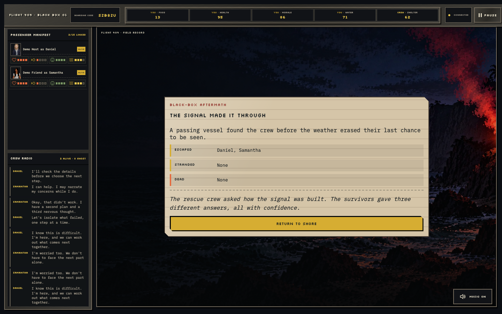
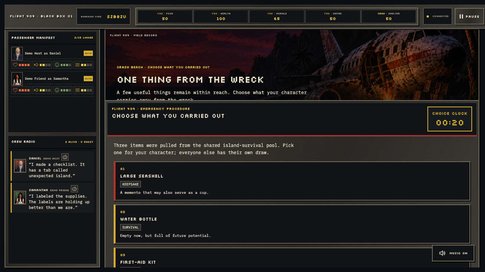
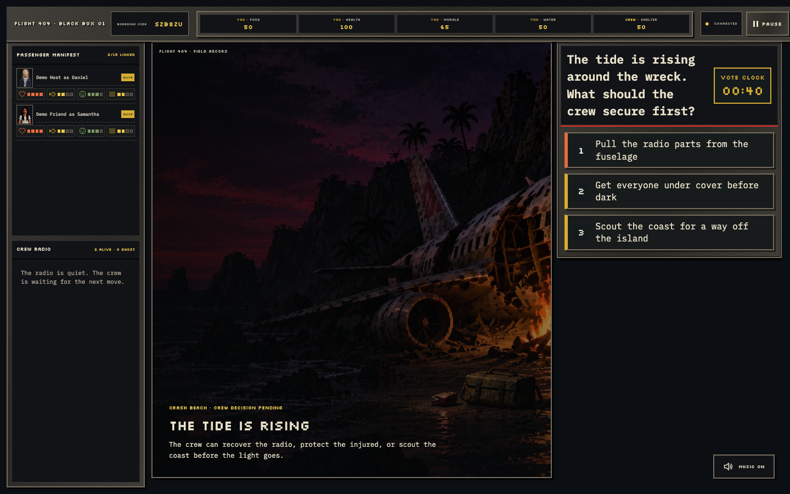
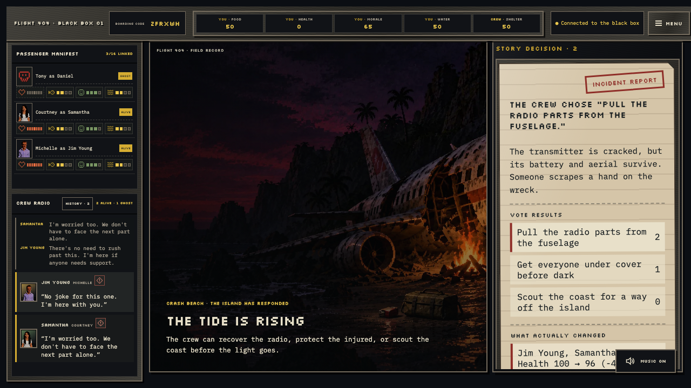

# Island of Extremely Questionable Judgment

<p align="center">
  
</p>

<p align="center"><strong>Game for the best team WebCMS.</strong><br />A cooperative, choice-driven survival story where the crew’s plans are only slightly more dangerous than the island.</p>

You and your friends are stranded after a crash. Choose what to take, decide whom to trust, and vote on how the crew responds to each crisis. The island remembers what you did: supplies run low, people get hurt, teammates can die, and the story branches toward rescue, escape, or a particularly embarrassing end.

## See the game

| Make the call | See what the crew chose | Live with the result |
| --- | --- | --- |
|  |  |  |

The game uses cinematic scene art, compact crew portraits, and a persistent radio so the people—and their reactions—stay at the center of play.

## What makes a run

- **Shared decisions:** each player votes, and the crew sees the group’s choices while a decision is open. Some selfish choices stay private.
- **A branching campaign:** choices change the crew’s resources, story flags, and which situations can happen next.
- **People with opinions:** survivors have distinct personalities and skills. Context-aware radio exchanges react to the event and its actual outcome.
- **Survival pressure:** food, health, morale, injuries, and the state of the crew shape the options ahead.
- **A crew that can change:** characters may survive, die, or continue as ghosts while the rest of the group plays on.
- **More than one way out:** work toward a signal rescue or try another escape route; the crew’s earlier decisions determine what is possible.

The tone is earnest survival drama interrupted by questionable judgment, workplace jokes, and the occasional Scrum or Drupal reference.

## Play locally

Requirements: Node.js 22.18 or newer.

```sh
npm ci
npm run dev
```

Open `http://127.0.0.1:5174/`, create a room, and join from a second browser or device to play together. The `/decision-test` route is a development bench for exploring story decisions without creating a lobby.

Useful project pages:

- [`/story-map`](src/game/screens/StoryMapScreen.tsx) — inspect the campaign branches and connections.
- [`/decision-test`](src/game/screens/DecisionTestScreen.tsx) — preview decisions, outcomes, and scene art.
- [`/team-feedback`](src/game/screens/TeamFeedbackPreviewScreen.tsx) — inspect deterministic scenarios for the newest survival mechanics.
- [`/sound-test`](src/game/screens/SoundTestScreen.tsx) — preview the game’s audio cues and music.

## Project status

This is an actively tested multiplayer prototype. The campaign and interface are being refined; automated checks cover important rules and play flows, but they do not prove every story branch or ending has been playtested.

The game is built with React, TypeScript, Vite, and React Three Fiber for character renders. Cloudflare Workers and a SQLite-backed Durable Object provide the multiplayer room runtime. Cloudflare deployment setup is in progress.

Start with the [project index](docs/README.md), [design brief](docs/GAME_DESIGN.md), [roadmap](docs/ROADMAP.md), and [asset permissions register](docs/licenses/assets.md).
