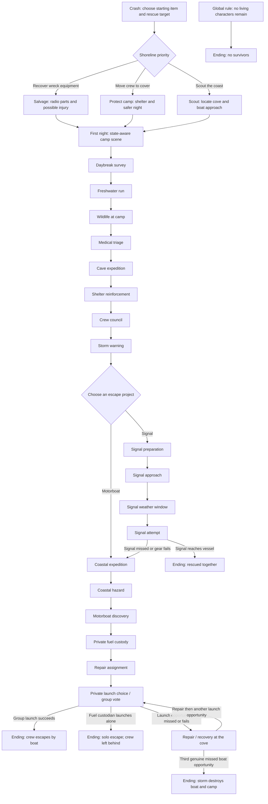

# First Island Campaign — Branch Map v1

**Status:** first playable campaign expansion implemented; full-route browser acceptance and balance tuning remain. The graph turns the approved direction into a bounded first campaign with choices that change later options, route difficulty, and endings.

## Narrative promise

The crash begins one connected story. Players decide what to save, who to help, what to prepare, and which escape plan to risk. Earlier decisions leave persistent facts that later scenes use. The story may reconverge at camp, but it must remember the crew's condition, supplies, clues, and route progress.

Randomness decides uncertain outcomes within a chosen action. It does not pick an unrelated next scene, decide which route the crew chose, or erase a previous consequence.

## First playable graph

This first arc has two escape projects: signal rescue and the existing motorboat. A raft is a later branch, once the graph and persistent state are proven. The first three shore choices are mutually exclusive, so runs establish different strengths and tradeoffs.

### How the opening branches cause later differences

**Recover wreck equipment:** yields a damaged radio component during the shoreline decision. A later assigned repair can make a powered signal attempt available. The daybreak fuselage search can separately recover bottles, crackers, and salvageable panels. If the component is not recovered, signal remains possible through an improvised smoke/flare plan with a clear extra cost and lower authored success chance; the branch never silently disappears.

**Move the crew to cover:** improves shelter/protection and improves the first-night rest outcome. The wreck stays exposed to the tide, so this choice does not also grant the radio component or boat parts. Camp may still send a later coast expedition; choosing shelter delays access, it does not permanently lock the story.

**Scout the coast:** records the cove's location and safe tide marks. The boat can still be reached without scouting, but only an early scout unlocks the extra tide-mark discovery choice. It does not mean the crew is already at the cove and does not grant radio parts.

The first-night node is a deliberate reconvergence: all players meet at camp, but its title, available preparation choices, and dialogue read the facts above. It now leads through a fixed sequence of morning survey, water, wildlife, triage, cave, shelter, council, and storm decisions before the escape project. Their resolved outcomes update supplies and story flags; signal and coastal routes then diverge before reconnecting to existing endings. A failed signal commits the crew to the coastal expedition; it does not return to the escape-project vote. Reconvergence is not a state reset.

Crew radio exchanges now use the saved public outcome ID and confirmed event facts. The dialogue selector never reads pending outcomes or individual votes; reports and radio reuse the same persisted result exchange. Missing authored outcomes use a restrained, character-voiced fallback. See `docs/design/2026-11-10-contextual-crew-dialogue.md` and `docs/qa/crew-dialogue.md` for coverage and tested scenarios.

## Persistent story facts

Store only facts with a later gameplay or narrative use. The server records the resolved fact once; clients never infer it from an animation or unverified choice.

| Fact | Set by | Used by |
|---|---|---|
| `startingItemByCharacter` | Crash item phase | Unlocks or improves an explicitly supported action; visible ownership follows privacy rules |
| `crashRescueAttempts`, `aliveCharacterIds` | Crash rescue resolution | Actor eligibility, cast dialogue, survival count, ending disposition |
| `radioRecovered` | Wreck salvage outcome | Enables powered radio repair and improves signal attempt |
| `radioRepaired` | First-night assigned repair | Enables the strongest signal option; repair can fail with a recorded consequence |
| `shelterCondition` | Cover/shelter choice and later damage | Modifies night exposure and repair-resource tradeoffs |
| `coveLocated` | Early coast scout or first-night lookout | Unlocks the scout's tide-mark discovery action; does not imply arrival |
| `coveReached` | Coastal hazard resolution | Records that the crew arrived at the cove before boat discovery |
| `signalAttempted`, `signalFailed` | Signal route resolution | Prevents repeating the same opportunity forever; failure commits the crew to the coastal expedition |
| Motorboat route facts | Existing motorboat rules | Fuel privacy, repair quality, missed tides, group/solo launch, storm ending |
| Resources, injuries, item ownership/consumption | Resolved events and survival ticks | Eligibility, costs, skill/risk modifiers, truthful consequences and epilogues |

Private facts such as hidden fuel stay private until the current rules reveal them. Public scene copy must not expose secret ownership early.

## Route and ending rules

### Signal rescue

- The route is selectable from the escape-project node even if the crew lacks a radio; show the real alternative (radio, flare, or smoke beacon) and its cost.
- Radio recovery and repair improve the attempt; ridge/cove scouting can improve the approach. These are modifiers from stored facts, not separate random scene selection.
- One signal attempt resolves to rescue or a specific setback. Success ends the session with a factual list of rescued, stranded, and dead characters. Failure consumes its recorded time/resources and returns the crew to the project choice if a viable route remains.
- Do not repeat the same failed signal as an unlimited reroll. If a second attempt is later designed, it needs a new opportunity and a clear cost.

### Motorboat

- Keep the current fuel discovery, private custody, repair assignment, group/solo launch, bounded recovery, and third-miss storm rules.
- `coveLocated` unlocks the early-scout discovery option; `coveReached` records physical arrival. Radio/flare signals, shelter condition, injuries, and owned tools may affect authored options or risk only after those effects are explicitly implemented and recorded.
- Group launch, solo escape, and storm/no-survivor outcomes remain driven by current rules and player decisions. Do not let a later story node overwrite a completed ending.

### Target first-arc endings

1. **Rescued together** — a successful signal rescue.
2. **Crew escapes by boat** — a successful group launch.
3. **Solo escape** — the fuel custodian succeeds alone; remaining crew are explicitly listed as stranded or dead.
4. **Storm loss** — three distinct genuine missed motorboat opportunities end in the existing storm surge.
5. **No survivors** — the crew dies before escaping.

These provide two different cooperative exits, a selfish mixed ending, and clear failures. Later content can add rescue-with-a-cost, raft escape, betrayal fallout, or a stranded-but-alive finale once those outcomes have precise rules. Don't multiply ending labels that describe the same actual cast outcome.

## Graph correctness rules

- Every node has a stable ID, explicit entry conditions, resolved outputs, and named eligible successors.
- Server state selects the next node. If a prerequisite is absent, offer a supported fallback or a truthful unavailable reason; never strand a run waiting for a random item.
- Every nonterminal state has at least one valid next step, and every route failure either costs something and returns to a valid decision or reaches an authored ending.
- A successful escape is terminal and takes precedence over later clocks or callbacks.
- A chosen option is not a result. Show success narration only after the server records the successful outcome.
- Reconnecting or replaying a resolved phase cannot apply resource/item/death effects twice.
- Graph review covers early deaths, no item, no radio, hidden fuel, absent/ghost assigned actor, failed signal, failed launch, and all eligible endings.

## Example runs: why these are different histories

- **Prepared rescuers:** recover and repair the radio, spend a night action on a lookout, then signal from high ground. The signal succeeds; the crew escapes without ever finding the boat.
- **Sheltered crew:** move to cover, preserve health and supplies, then search the coast later. Boat repair is harder because no repair parts were salvaged, but the crew can still choose that route.
- **Coast-first crew:** scout the cove, discover the boat early, share fuel, and launch together. If the custodian hides fuel instead, a private choice can produce the solo-escape ending.
- **Unlucky and divided crew:** the improvised signal fails, the group loses resources, and repeated boat attempts consume the remaining safe tides. The storm ending follows the recorded missed opportunities, not an arbitrary bad-ending roll.

## Implementation status and remaining work

The server-owned campaign state, new survival scenes, story flags, signal preparation/approach/window sequence, and coastal expedition/hazard route are implemented. Existing signal rescue and motorboat endings remain the route endpoints. Public state projection and older-room migration are included. Next, play complete two-client runs through both routes, validate all branch links and ending reachability, and tune the target session length from observed play rather than extending the route blindly.
