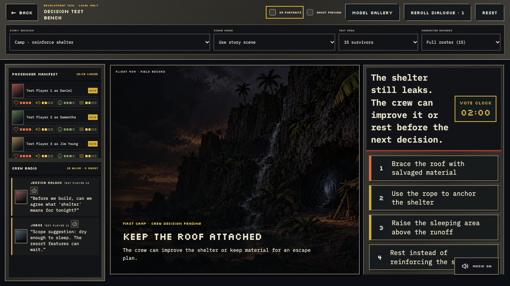
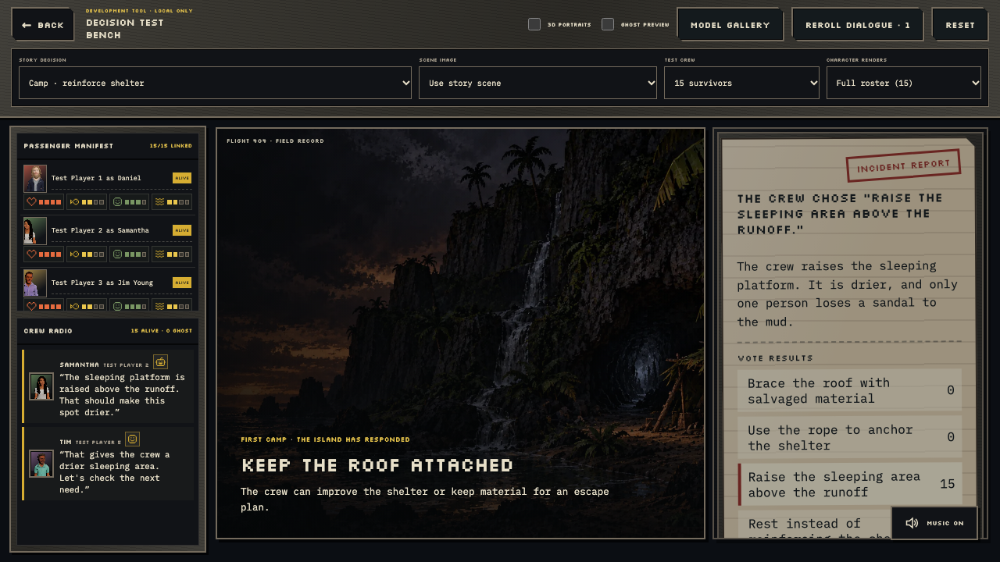
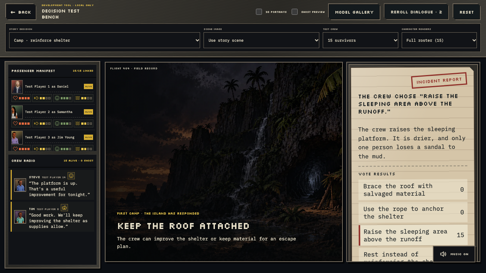
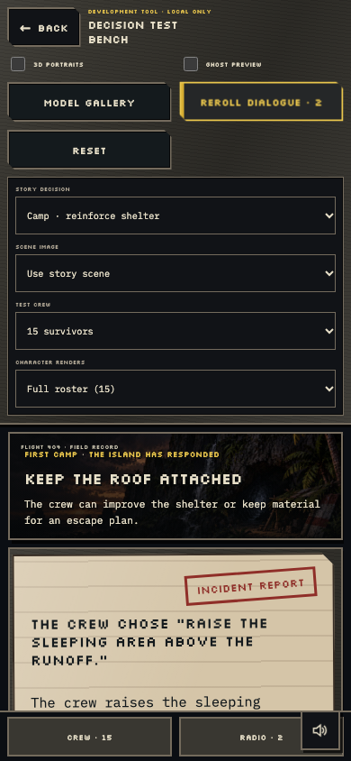

# Contextual crew dialogue QA

**Run date:** 2026-11-10  
**Scope:** contextual radio and incident-report dialogue, decision-opening exchanges, persistence, deterministic preview selection, and the first campaign outcome cases.

## Result

The selected checks passed:

- TypeScript app and Worker checks (`npm run typecheck`).
- Shared dialogue/profile/protocol/presentation and consequence-panel tests: 50 tests passed across the final focused run.
- Worker gameplay, assignment, lobby, motorboat, and crash-rescue tests: 35 tests passed.
- Decision bench Playwright flow: 1 test passed in 5.1 seconds on the final run (12.1 seconds on the first screenshot-capture run).
- Three-client live Playwright flow: 1 test passed in about 1.0 minute on the final run.
- Full two-client campaign Playwright run: 1 test passed in 7.1 minutes, reached a terminal signal-rescue ending after 15 decisions.
- Failed-signal route integration: 1 deterministic Worker test passed, following failure through the coast and cove to motorboat discovery, then confirming the storm recovery decision is offered after a missed launch.
- Full Worker suite: 50 tests passed across 8 files.
- `git diff --check` passed.

## Broader regression run

The complete unit/client suite is not green in the current workspace: **35 files passed, 8 failed; 206 tests passed, 7 failed, and 4 were skipped**. The failing files were `characterCatalog`, `characterManifest`, `privateChoicePanel`, `assignmentResponsePanel`, `uiLab`, `islandSandbox`, `islandLevel`, and `audioManifest`. Reported causes included manifest URL/schema mismatches, queries matching both an option and its nomination control, missing `ResizeObserver` in the test environment, and island-layout expectations. These failures are outside the contextual-dialogue tests and remain open in the broader workspace.

The live test verified that connected clients show identical radio lines, the incident report uses the same exchange, and a reloaded client restores that exchange. The local bench verified that changing the dialogue seed leaves the selected outcome and resource report unchanged. The mobile check used a 390 × 844 viewport and confirmed visible radio access without horizontal page overflow.

The full campaign run exercised crash rescue, shoreline, first night, daybreak, freshwater, wildlife, triage, cave, shelter, council, storm, route choice, signal preparation, approach, weather window, signal attempt, and signal-rescue ending with two connected clients. It resolved 15 decisions in 7.1 minutes.

## Screenshots

The full-campaign ending capture is [available here](../../output/playwright/adaptive-cinematic-ui/ending-aftermath-desktop.png). Decision 1, 5, and 10 reports were also captured in that folder.

Decision-opening conversation with all 15 characters in the session:

Resolved platform outcome and matching crew exchange:

Dialogue-only reroll with unchanged result:

Mobile radio access:

## Content checks

- The opening exchange is attached to the selected decision before any result exists.
- Resolved exchanges are stored on the event and reused by the radio, report, and reconnecting clients.
- The shelter platform outcome has its own dialogue; it does not claim the whole shelter was completed.
- Rain collection and spring discovery have different dialogue; the rain catch does not imply a spring or marked route.
- Fresh death and outcome-caused injury use serious responses; ordinary daily health consumption is not treated as a new injury.
- Role-specific exchanges require the appropriate present roles. Missing role combinations use character-voiced context-safe lines.
- Recent repeated templates and tagged workplace-joke motifs are suppressed.

## Limits

This validates the current dialogue slice, a full signal-rescue browser run, and the failed-signal-to-motorboat state-machine route, not every campaign outcome in every cast combination. The failed-signal route was not driven through a complete browser campaign in this QA pass. Unmatched outcomes use a restrained, character-voiced fallback. No balance or survival rules were changed by dialogue selection.
